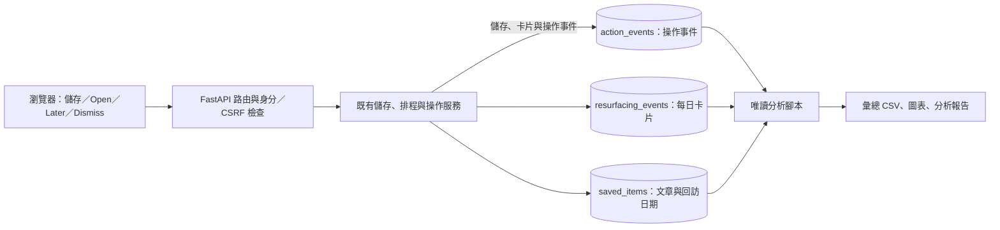

# RecallFlow 短演示腳本

這段演示的目標是讓觀眾在約 82 秒內理解：為甚麼要回訪收藏、日期如何決定卡片出現，以及使用者如何掌握下一步。

本機錄製已於 2026-10-27 完成：[觀看演示](media/recallflow-demo.mp4)。成片經 FFmpeg 核對為 **82.04 秒、1280 × 900、H.264**，附繁體中文字幕，沒有音軌。[錄製中繼資料](media/recallflow-demo.json) 記錄三個情境的實際檢查結果與彙總事件；[封面](media/demo-poster.png) 擷取自成片。

## 示範資料與拍攝邊界

- 畫面持續標示 **DEMO DATA · 本機腳本演示**。三個帳號及文章均為示範資料，沒有真實參與者，也不能用來宣稱使用者驗證或留存效果。
- 使用獨立的 `data/recallflow-demo.db`，不要連接日常使用的資料庫、讀取真實邀請碼或覆寫現有資料。
- 示範工具固定時鐘，並注入合成文章與模擬的連結檢查結果。表單、卡片、狀態流轉及事件仍經由現有應用程式流程執行；這段演示不證明真實網路擷取或安全檢查已通過。
- 錄影中的來源網址為 `http://demo.recallflow.test/demo/source/open` 等合成網址，使用預設連接埠。Playwright 僅攔截這個來源主機的 `/demo/source/**`，以本機示範伺服器的內容回應；不修改系統 hosts 或 DNS，也不連接真實原文網站。正式應用程式仍拒絕非預設來源連接埠與私人網路目標，未為錄影放寬安全規則。
- 三個帳號分別示範 Open、Later、Dismiss／Undo，遵守每名使用者每天最多一張新卡片的規則。切換時明確標示帳號角色。
- `source_opened` 只表示完成應用程式的連結檢查並發出導覽交接；不表示網頁已呈現，也不表示使用者已閱讀。
- 新的儲存路由會發出 `capture_started` 與 `capture_succeeded`／`capture_failed`，但無法補回舊版未記錄的操作。若觀察期間沒有可判定的保存結果，保存操作成功率應輸出 **N/A**；不能以已儲存文章數推測成功率，也不能補造歷史事件。保存成功與正文抽取成功須分開看。
- 不展示真實 `.env`、權杖、瀏覽器私人分頁、真實文章正文快照或可識別使用者的資料。

## 約 82 秒分鏡

| 時間 | 畫面與操作 | 字幕／旁白重點 |
| --- | --- | --- |
| 00:00–00:05 | 標題與示範資料標示，進入本機 RecallFlow。 | 「收藏了有用的文章，卻常常忘記再看。RecallFlow 讓你自己決定何時重新遇見它。」 |
| 00:05–00:20 | 示範帳號 A：進入 Save an article，填寫示範網址、用途、回訪日期與一句備註，點選 Save article；顯示儲存完成。 | 「儲存文章連結，設定回訪日期。七天只是初始預設，不是經驗驗證的最佳時間。」 |
| 00:20–00:27 | 回到 Saved items，顯示已到期的卡片，指出 Why now 中的日期。 | 「到期後回到這個頁面，每名使用者每天最多選出一篇到期文章。」 |
| 00:27–00:34 | 帳號 A：點選 Open，顯示明確標示為示範內容的來源頁。 | 「Open 是導覽交接，不等於已讀。」 |
| 00:34–00:50 | 切換至示範帳號 B：點選 Later，選擇三天或七天，顯示新的回訪日期與已完成狀態。 | 「現在沒空，就挑一個更合適的日期。」 |
| 00:50–01:05 | 切換至示範帳號 C：點選 Dismiss，顯示文章仍保留但不再浮現；30 秒內點選 Undo Dismiss，顯示復原結果。 | 「不想再看，可以停止浮現；誤操作也有 30 秒可以復原。」 |
| 01:05–01:12 | 在帳號 C 暫停，再恢復浮現，顯示狀態變化。 | 「也可以暫停全部浮現，文章和日期保持不變。」 |
| 01:12–01:22 | 顯示下方資料流程圖。 | 「後端將文章、卡片和事件存進 SQLite，再以唯讀腳本產生彙總。這是示範事件分析，不是真實使用者成效。」 |

每次切換帳號保留可辨識的字幕。若剪接等待時間，避免把跨日流程剪成同一帳號一天產生多張新卡片；在字幕註明固定示範日期或時間推進。

## 結尾資料流程圖

可直接使用 [1280 × 720 SVG 圖](media/data-flow.svg) 作為影片最後一幕；圖中已標示示範資料、每天一張新卡片、Open 的狹義定義，以及歷史事件覆蓋率的限制。



圖中的三個資料表位於同一個本機 SQLite 資料庫。文章正文快照只留在私人資料庫；公開交付使用合成內容與彙總結果。

這張圖不是「所有歷史流程皆已有完整事件」的宣稱。新加入的保存結果事件不能補回舊版操作；觀察期間沒有終態結果時仍輸出 N/A。

## 工具與指令

以下指令從專案根目錄執行。示範資料庫名稱不可指向既有私人資料庫；工具遇到已存在的示範資料庫時不覆寫，重跑請換一個新的檔名。

生成事件分析用的獨立資料庫，再以明確 UTC 期間分析：

```powershell
.\.venv\Scripts\python.exe -m scripts.generate_demo_usage --database data/recallflow-usage-demo.db
.\.venv\Scripts\python.exe -m scripts.analyze_usage --database data/recallflow-usage-demo.db --start 2026-10-26T00:00:00Z --end 2026-10-27T00:00:00Z --data-kind demo --output-dir reports
```

輸出為 `reports/usage_summary.csv`、`reports/usage_metrics.svg`、`reports/usage_analysis.md`。腳本透過正常應用程式路由產生合成操作事件，不向資料庫補寫虛構的歷史分析事件。這份資料與影片錄製用資料庫分開。

錄影另外安裝可選依賴；一般應用程式與分析腳本不需要這些套件：

```powershell
.\.venv\Scripts\python.exe -m pip install -r requirements-demo.txt
.\.venv\Scripts\python.exe -m playwright install ffmpeg
.\.venv\Scripts\python.exe -m scripts.record_demo --help
.\.venv\Scripts\python.exe -m scripts.record_demo --database data/recallflow-recording-demo-new.db --output docs/media/recallflow-demo.mp4
```

錄影工具使用 Playwright，以 headless Chrome 呈現並錄製實際網頁 UI，再由 imageio-ffmpeg 的 FFmpeg 編碼本機影片。預設使用已安裝的 Chrome；也可用 `--browser-executable` 指定既有 Chrome／Chromium 路徑。它建立隔離瀏覽器工作階段與合成資料，擷取及連結檢查使用示範替身；不讀取日常 Chrome 個人資料，也不放寬正式應用程式的 URL 安全規則。

輸出包含影片、同名 `.json` 中繼資料、`docs/media/demo-poster.png`，以及 `reports/internal_walkthrough.md` 的已執行情境紀錄。原始片段保存在已忽略的 `exports/`；影片或資料庫已存在時，請改用新路徑，不覆寫既有成品。錄影腳本會檢查最終片長是否在 60–90 秒之間。

錄影成片是應用程式 UI 的腳本操作，非真人使用測試；畫面停留、片段剪接與字幕用來讓操作結果清楚可讀。最終時長以實際影片的驗證紀錄為準。

## 本輪發現與驗證

- 原保存路由沒有發出結果事件；已補上可按操作 UUID 去重的 `capture_started` 與成功／失敗終態，抽取 fallback 仍算保存成功。
- 實際瀏覽器走查發現未處理卡片在重新整理後消失；已修正為重用同一張已展示卡片，操作保持可用，不新增曝光或每日名額。
- 三個錄影片段的情境檢查通過，三個帳號共三張卡片、三次曝光。影片資料庫與分析報告的示範資料庫分開；分析報告另含刻意模擬的失敗與重試，不應把兩份事件筆數混為一談。
- 完整測試：`175 passed`，兩條既有依賴棄用警告。沒有招募真人，也沒有填造真人耗時、引述或留存結果。

## 重現與驗收

1. 依 README 安裝依賴，使用示範工具建立全新的獨立資料庫，保留工具輸出的示範帳號資訊於本機。
2. 啟動只監聽 loopback 的示範應用程式；示範用擷取器與連結檢查器不得替換正式應用程式設定。
3. 使用三個獨立登入工作階段，依照分鏡操作。卡片必須由瀏覽器確認掛載，才算實際展示。
4. 錄製瀏覽器視窗與結尾圖，加入持續可見的 DEMO DATA 標示及帳號角色字幕。
5. 驗證成片為 60–90 秒、文字清楚、所有操作結果可見；檢查沒有曝光私人資料或憑證。
6. 分析腳本另指定觀察開始與結束時間，以示範資料標記輸出。記錄它分析的是錄影資料庫或另外生成的自動化示範資料，兩者不可混稱。

指標計算與可解讀範圍見 [評估方法](evaluation-methodology.md)。自動化情境紀錄位於 `reports/internal_walkthrough.md`，應按實際執行結果填寫；真人可用性測試另見 [小規模使用測試計畫](usability-test-plan.md)，尚未執行。
